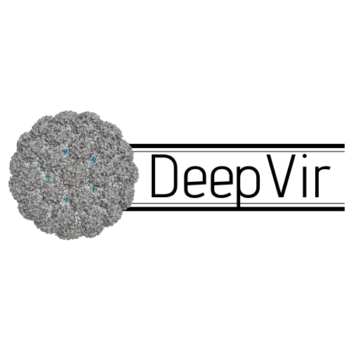
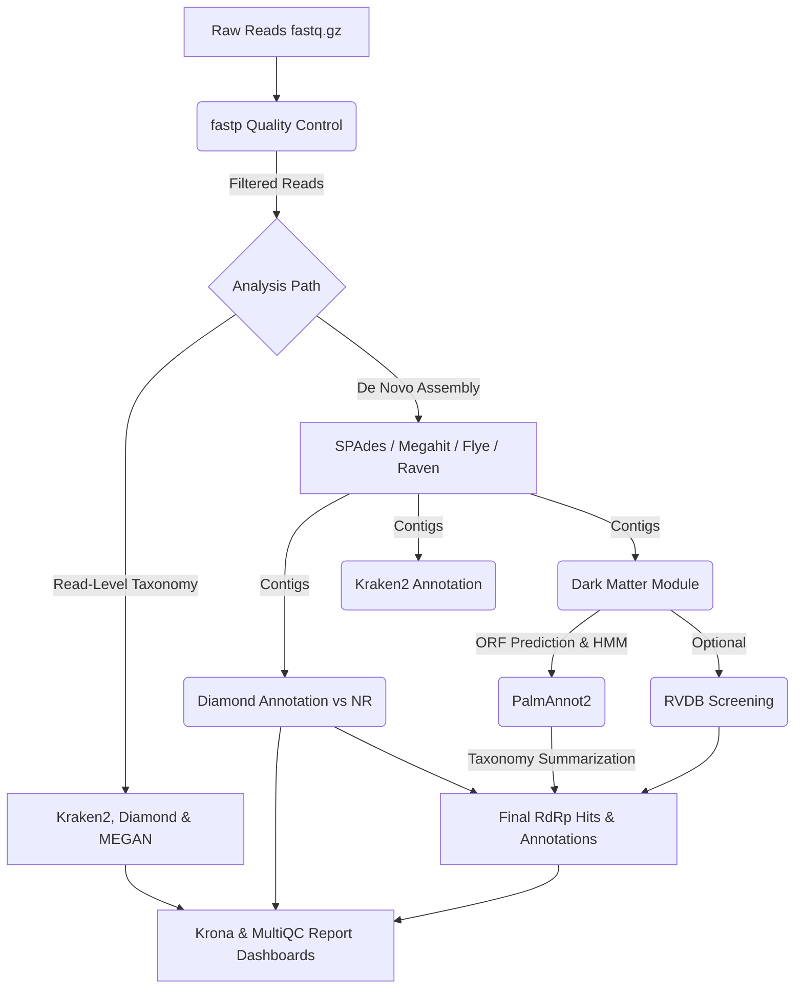
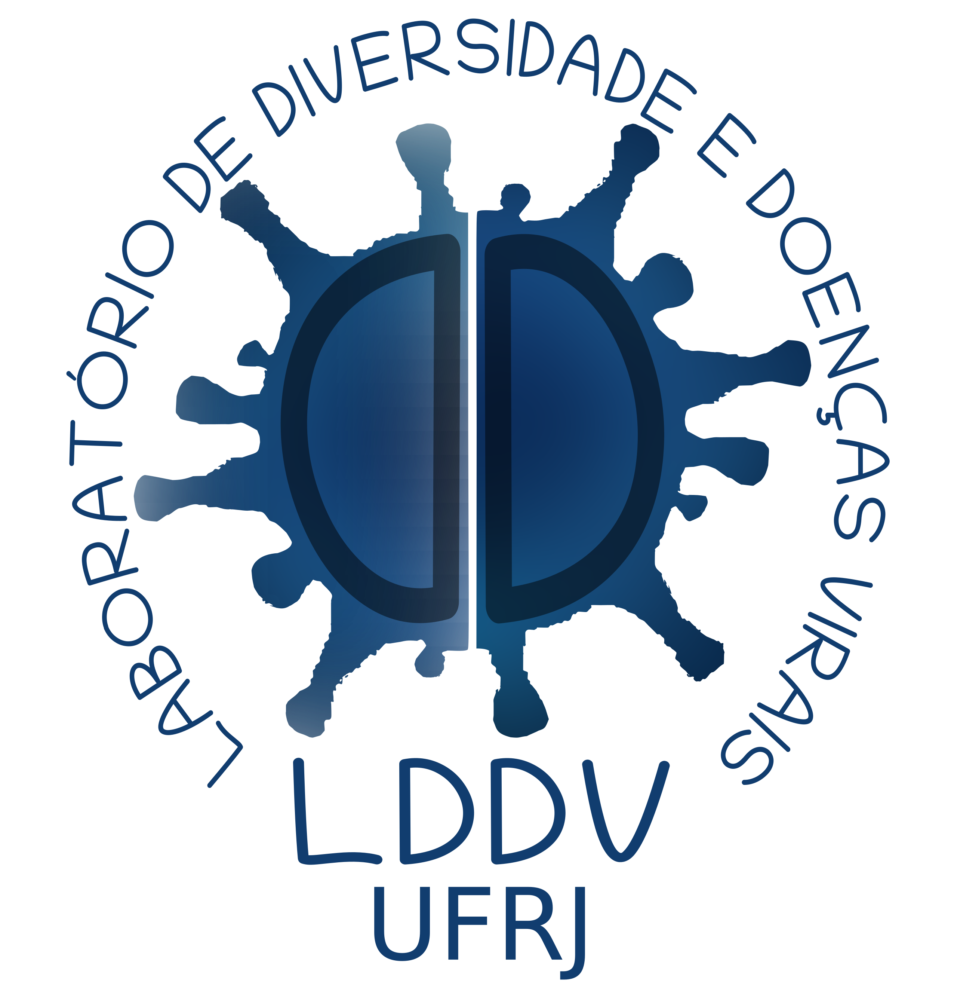

# DeepVir 2.0: Reproducible Viral Discovery Pipeline

[](README.md)
[](https://www.python.org/)
[](https://snakemake.readthedocs.io)
[](pipeline/workflow/envs/DeepVir.yaml)
[](docs/LICENSE)

<p align="center">
  
</p>

> [!TIP]
> **New to DeepVir?** Start with our **[Local Usage & 1st Time Setup](docs/local_use.md)** to quickly set up Conda, prepare lightweight test databases, and run the pipeline via the **Python CLI** or **1-Click Desktop GUI**.

---

## Table of Contents

- [Introduction](#introduction)
- [Repository Architecture](#repository-architecture)
- [Pipeline Presentation](#pipeline-presentation)
- [Requirements & Dependencies](#requirements--dependencies)
- [Quick Start & Execution (Python)](#quick-start--execution-python)
- [Tutorials & Guides](#tutorials--guides)
- [Contributing](#contributing)
- [License](#license)
- [Author](#author)

## Introduction

**DeepVir** is a comprehensive and scalable Snakemake workflow orchestrated in **pure Python** for the detection of novel viruses within High-Throughput Sequencing (HTS) data. The pipeline works seamlessly with both short-read (Illumina) and long-read (Nanopore/PacBio) metagenomic and metatranscriptomic datasets across **Linux**, **macOS** (Intel & Apple Silicon), **Windows (via WSL2 bridge)**, and **HPC (Slurm)** clusters.

## Repository Architecture

DeepVir is organized into three main directories plus root launchers:

```text
DeepVir/
├── DeepVir.py                  # Universal Cross-Platform Python Executor (CLI + GUI + WSL Bridge)
├── DeepVir_gui.bat             # 1-Click Desktop Launcher for Windows (with WSL fallback)
├── DeepVir_gui.command         # 1-Click Desktop Launcher for macOS (Finder)
├── DeepVir_gui.sh              # 1-Click Desktop Launcher for Linux / WSL
├── pipeline/                   # 1. Pipeline Backend & GUI Engine
│   ├── config/                 # Global workflow parameters (config.yaml)
│   ├── gui/                    # Interactive Tkinter Desktop Dashboard (deepvir_gui.py)
│   ├── profiles/               # Snakemake execution profiles (local, profile_slurm)
│   ├── resources/              # Databases, HMM models (PalmAnnot), and logos
│   └── workflow/               # Snakemake Snakefile, modular rules (.smk), Conda envs & scripts
├── docs/                       # 2. License & Markdown Documentation / Tutorials
└── logs/                       # 3. Centralized Execution Logs, Rule Logs & Run Overrides
```

## Pipeline Presentation



## Requirements & Dependencies

### Recommended Hardware Specs
- **Memory (RAM)**: Minimum 32GB (for metaSPAdes/rnaviral assembly). 64GB+ recommended for large metatranscriptomic datasets.
- **CPU**: 8–16+ cores recommended.
- **Disk Space**: At least 100GB+ available space to store external databases on local machines or HPC clusters.

### Dependencies (Python, Conda & Databases)
- **Python 3.8+** (standard library only for the orchestrator `DeepVir.py`).
- **Conda / Mamba / Miniforge**: DeepVir uses Snakemake's native `--use-conda` integration to automatically provision isolated tool environments defined in [`pipeline/workflow/envs/`](pipeline/workflow/envs).
- **Databases**: See **[Local Usage & 1st Time Setup](docs/local_use.md)** for lightweight test databases and **[Full Databases Setup](docs/full_databases_setup.md)** for full production databases (Kraken2 & NCBI NR for DIAMOND).

## Quick Start & Execution (Python)

The [`DeepVir.py`](DeepVir.py) script is the universal Python entry point. It detects your operating system (Linux, macOS, or Windows with automatic WSL path translation), activates the `DeepVir` Conda environment, generates `logs/run_overrides.yaml`, and orchestrates Snakemake.

### 1. Clone the repository

```bash
git clone https://github.com/matheus-cosentino/DeepVir.git
cd DeepVir
```

### 2. Launch the Interactive Desktop GUI (1-Click or Python)

- **Windows**: Double-click **`DeepVir_gui.bat`**
- **macOS**: Double-click **`DeepVir_gui.command`**
- **Linux**: Run **`./DeepVir_gui.sh`**
- **Any OS via Python**:
  ```bash
  python DeepVir.py --gui
  ```
  *(Note: Running `python DeepVir.py` with no arguments also launches the Desktop GUI automatically.)*

### 3. Command-Line Interface (CLI) Usage

Verify the CLI options with:

```bash
python DeepVir.py --help
```

```text
usage: DeepVir.py [-h] [-v] [-g] [--input DIR] [--output DIR] [--sra FILE]
                  [--jobs INT] [--profile NAME] [--temp-dir DIR]
                  [--diamond_db FILE] [--kraken2_db DIR] [--reads-kraken]
                  [--reads-diamond] [--assembly]
                  [--assembler {spades,megahit,flye,raven,medaka_flye,medaka_raven}]
                  [--fastp-length INT] [--fastp-quality INT] [--kraken2]
                  [--diamond] [--darkmatter] [--rvdb] [--remove-download]
                  [--download-only] [--dry-run]

DeepVir: Viral Metagenomics & 'Dark Matter' Discovery (Universal Python Executor)

options:
  -h, --help            show this help message and exit
  -v, --version         Show version
  -g, --gui             Launch interactive Desktop GUI (Python/Tkinter)

Input / Output & Execution:
  --input DIR           Directory containing raw reads (.fastq.gz) or contigs (.fasta)
  --output DIR          Directory where results will be saved
  --sra FILE            Text file containing SRA Accession IDs for download
  --jobs INT            Number of parallel jobs/cores (default: 15)
  --profile NAME        Snakemake profile under pipeline/profiles/ (default: local)
  --temp-dir DIR        Temporary scratch directory (default: /tmp)

Database Overrides:
  --diamond_db FILE     External Diamond database (.dmnd)
  --kraken2_db DIR      External Kraken2 database directory (hash.k2d, opts.k2d, taxo.k2d)

Analysis Module Toggles:
  --reads-kraken        Taxonomic classification of raw reads using Kraken2
  --reads-diamond       Taxonomic classification of raw reads using DIAMOND + MEGAN
  --assembly            Enable de novo assembly of reads into contigs
  --assembler {spades,megahit,flye,raven,medaka_flye,medaka_raven}
                        Select de novo assembler engine (default: spades)
  --fastp-length INT    Minimum read length filter for fastp
  --fastp-quality INT   Minimum Phred quality score for fastp
  --kraken2             Taxonomic classification of assembled contigs using Kraken2
  --diamond             Taxonomic classification of assembled contigs using DIAMOND
  --darkmatter          Enable 'dark matter' module to search for RdRp signatures
  --rvdb                Enable optional RVDB validation on dark matter ORFs
  --remove-download     Remove SRA raw files after workflow completion
  --download-only       Download SRA files only and stop before analysis
  --dry-run             Run Snakemake in dry-run mode (preview DAG only)
```

## Tutorials & Guides

To make it easier to navigate, all documentation is available in [`docs/`](docs/):

- **[Local Usage & 1st Time Setup](docs/local_use.md)**: Start here! Learn how to install Conda, prepare lightweight test databases, and run DeepVir locally with Python.
- **[Desktop GUI Guide (Python)](docs/desktop_gui.md)**: Complete walkthrough of the interactive graphical interface, 1-click launchers, real-time console, and HTML report viewers.
- **[Full Databases Setup](docs/full_databases_setup.md)**: Instructions on how to download and format full production databases for Kraken2 and DIAMOND (NR).
- **[HPC (Slurm) Usage Guide](docs/hpc_use.md)**: Instructions for running the pipeline on an HPC cluster using `python3 DeepVir.py --profile profile_slurm`.
- **[Advanced Configuration Tutorial](docs/advanced_tutorial.md)**: Practical guidance on `fastp` tuning, assembler selection, SPAdes settings, and long-read assembly parameters.
- **[Working with Public Data (SRA)](docs/public_data_usage.md)**: Learn how to incorporate publicly available NCBI SRA runs directly into the pipeline.
- **[Expected Outputs & Logs](docs/expected_outputs.md)**: Detailed reference of the files generated in `results/` and execution logs in `logs/`.
- **[Pipeline Structure & DAGs](docs/structure_and_dags/workflow_structure.md)**: Detailed documentation of the 3-directory repository architecture and execution DAGs (EN / PT / FR).

## Contributing
Contributions are welcome! If you find a bug or have a suggestion for improvement, please open an issue.

## License
This project is licensed under the [GNU General Public License v3.0](docs/LICENSE).

## Author
MSc. Matheus Cosentino

---
<div align="center">
  
  
</div>
