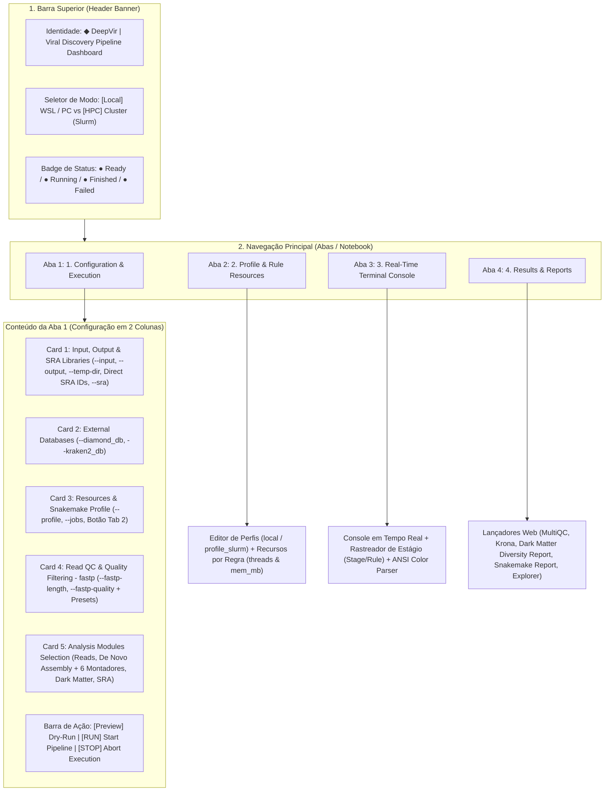

# DeepVir GUI — Guia Completo da Interface Gráfica e Diagnóstico de Símbolos

O **DeepVir GUI** (`pipeline/gui/deepvir_gui.py`) é o painel gráfico interativo do pipeline **DeepVir**, desenvolvido em **Python (Tkinter/TTK)** com tema escuro (*Dark Slate & Emerald*) para configuração, execução em tempo real via executor universal Python (`DeepVir.py`) e visualização de relatórios HTML no navegador (em **Windows + WSL**, **macOS**, **Linux** e clusters **HPC / Slurm**).

---

## 1. Estrutura Organizacional em 3 Diretórios e Inicialização 1-Clique

O projeto está organizado em três diretórios principais:
1. **`pipeline/`**: Todo o código-fonte do pipeline e backend (`workflow/`, `config/`, `profiles/`, `resources/`, `gui/deepvir_gui.py`).
2. **`docs/`**: Licenças (`LICENSE`) e documentações em Markdown (`*.md`).
3. **`logs/`**: Todos os logs de execução da GUI (`deepvir_desktop_gui.log`, `save.log`), logs individuais de cada regra do Snakemake (`logs/<sample>/*.log`) e histórico de overrides (`run_overrides_<timestamp>.yaml`).

### Como Iniciar a Interface (1-Clique Multiplataforma)

- **No Windows (com WSL)**: Dê duplo-clique em **`DeepVir_gui.bat`** na raiz do projeto.
- **No macOS (Finder)**: Dê duplo-clique em **`DeepVir_gui.command`** na raiz do projeto.
- **No Linux / WSL**: Execute ou dê duplo-clique em **`DeepVir_gui.sh`** na raiz do projeto.
- **Via Python Universal (qualquer máquina)**:
```bash
python DeepVir.py --gui
# ou simplesmente sem argumentos:
python DeepVir.py
```

---

## 2. Arquitetura Visual e Explicação de Cada Parte da Interface



### 2.1. Barra Superior (*Top Header Banner*)
Localizada no topo fixo da janela (`lines 201–232` de `gui/deepvir_gui.py`), contém três elementos:
1. **Título do Sistema (`◆ DeepVir | Viral Discovery Pipeline Dashboard`)**: Identificação visual do painel.
2. **Seletor de Ambiente de Execução (`[Local] WSL / PC` vs `[HPC] Cluster (Slurm)`)**:
   - Ao selecionar **`[Local] WSL / PC`**, a interface altera automaticamente o perfil do Snakemake para `local` e ajusta a concorrência padrão para `8` threads.
   - Ao selecionar **`[HPC] Cluster (Slurm)`**, altera o perfil para `profile_slurm` e ajusta o limite para `15` jobs simultâneos na fila Slurm.
3. **Badge Dinâmico de Status (`self.lbl_status_badge`)**:
   - **`● Ready`** (Verde): Interface pronta para iniciar uma rodada.
   - **`● Running (Dry-run)` / `● Running Pipeline...`** (Âmbar): Subprocesso `DeepVir.py` ativo em segundo plano.
   - **`● Finished with Success`** (Verde): Execução finalizada com código de saída `0`.
   - **`● Execution Failed` / `● Aborted`** (Vermelho): Erro durante a execução ou interrupção manual pelo usuário.

---

### 2.2. Aba 1: `▸ Configuration & Execution`
Dividida em duas colunas responsivas para separar parâmetros de infraestrutura/arquivos (coluna esquerda) dos módulos científicos de análise (coluna direita):

#### Coluna Esquerda — Caminhos, Bancos, Recursos e Controle de Qualidade
1. **`◆ Input & Output Paths`**:
   - **Input Directory (`--input`)**: Pasta contendo as reads brutas (`.fastq.gz`, `.fastq`) ou contigs pré-montados (`.fasta`). Na rodada do `save.log`, foi utilizado `/mnt/d/DeepVir/data`.
   - **Output Directory (`--output`)**: Pasta de destino dos resultados, estatísticas, relatórios e logs (`/mnt/d/DeepVir/results`).
   - **Temporary Scratch Directory (`--temp-dir`)**: Diretório temporário para shadow dirs, ambientes Conda e arquivos intermediários (`/tmp`, resolvido automaticamente pelo `DeepVir.py` para `/tmp/<usuario>`).
   - **SRA Accessions File (`--sra`, opcional)**: Arquivo `.txt` com códigos de acesso do NCBI SRA (um por linha). Na rodada do `save.log`, foi passado `/mnt/d/DeepVir/betatu.txt` contendo a amostra `SRR10677983`.
   - Todos os campos possuem botão **`Browse...`** que abre a janela nativa de seleção de pastas/arquivos do sistema operacional.
2. **`◆ External Databases (Optional)`**:
   - **DIAMOND Database (`--diamond_db`)**: Caminho para um arquivo `.dmnd` externo (cria link simbólico em `resources/diamond/`).
   - **Kraken2 Database (`--kraken2_db`)**: Pasta contendo os índices `hash.k2d`, `opts.k2d` e `taxo.k2d` do Kraken2 (cria link simbólico em `resources/kraken2/`).
3. **`◆ Resources & Snakemake Profile`**:
   - **Profile (`--profile`)**: Combobox para escolha entre `local` (`profiles/local`) e `profile_slurm` (`profiles/profile_slurm`).
   - **Jobs / Threads (`--jobs`)**: Spinbox numérico (`1` a `128`) que define quantos núcleos/jobs o Snakemake pode utilizar simultaneamente (no `save.log` foi configurado como `--jobs 2`).
4. **`◆ Read QC & Quality Filtering (fastp)`**:
   - **Min Length (`--fastp-length`)**: Comprimento mínimo da read após trimagem em pares de bases (padrão: `30 bp`).
   - **Min Phred Quality (`--fastp-quality`)**: Índice Phred mínimo exigido (padrão: `30 Q`).
   - **Presets Rápidos**: Botões de 1 clique para **`Illumina (L: 30, Q: 30)`** e **`Nanopore / Long-read (L: 500, Q: 10)`**.

#### Coluna Direita — Módulos de Análise e Barra de Execução
1. **`▸ Read-Level Taxonomy (Fast Screening)`**:
   - `--reads-kraken`: Classificação taxonômica direta das reads filtradas via Kraken2.
   - `--reads-diamond`: Alinhamento das reads contra banco proteico via DIAMOND + análise de LCA no MEGAN.
2. **`▸ De Novo Assembly & Contigs`**:
   - **De Novo Reads Assembly (`--assembly`)**: Chave mestra que habilita a montagem *de novo* e ativa o subpainel **`Assembler Engine Selection (tool.denovo)`** (`--assembler`):
     - `SPAdes` (`--rnaviral`, padrão para RNA/vírus em leituras curtas Illumina — utilizado no `save.log`).
     - `MEGAHIT` (montador rápido e de baixo consumo de RAM para Illumina).
     - `Flye` (montador para leituras longas Nanopore / PacBio).
     - `Raven` (montador rápido para leituras longas Nanopore).
     - `Medaka + Flye` e `Medaka + Raven` (polimento de consenso para leituras Oxford Nanopore).
   - **Classificação de Contigs**:
     - `--kraken2`: Classificação taxonômica dos contigs montados via Kraken2 + geração de arquivo BIOM e gráfico Krona.
     - `--diamond`: Filtro de tamanho mínimo de contigs, alinhamento `diamond blastx`, mapeamento `accession2taxid`, adição de linhagem completa (`taxonkit`) e gráfico Krona.
3. **`▸ Viral Discovery / Dark Matter Module`**:
   - `--darkmatter`: Triagem de motivos catalíticos de RdRp viral via **PalmAnnot** em ORFs preditas dos contigs sem hit conhecido.
   - `--rvdb`: Validação cruzada das ORFs contra o banco de referência viral **RVDB** (HMMER).
4. **`▸ SRA Data Management`**:
   - `--download-only`: Apenas baixa os arquivos FASTQ do SRA e encerra.
   - `--remove-download`: Remove os FASTQs brutos baixados do SRA após a conclusão do pipeline para economizar disco.
5. **Barra Inferior de Execução (`Action Bar`)**:
   - **`▸ Dry-Run (Preview)`**: Executa `python DeepVir.py ... --dry-run` para validar o grafo DAG de regras do Snakemake sem processar os dados pesados.
   - **`▶ Run Pipeline`**: Inicia a execução completa em uma *worker thread* assíncrona via `DeepVir.py` e alterna automaticamente para a Aba 2 (Console).
   - **`■ Stop / Abort`**: Envia sinal `SIGTERM` ao processo ativo para interromper a execução imediatamente.

---

### 2.3. Aba 2: `▸ Real-Time Terminal Console`
Painel de monitoramento em tempo real da saída padrão (`stdout` e `stderr`) do `DeepVir.py` e do `snakemake`:
1. **Contador de Linhas (`0 lines`)**: Atualiza em tempo real o total de linhas recebidas no console.
2. **Rastreador de Estágio e Regra (`Stage: ...` / `Rule: ...`)**:
   - Analisa automaticamente as linhas do log (baseado na estrutura do `save.log`) para exibir em qual etapa o pipeline está:
     - `Stage: Checking Conda Env` → `Stage: Scanning Samples` → `Stage: Unlocking Workdir` → `Stage: Snakemake Dry-Run (DAG)` → `Stage: Main Execution` → `Stage: Creating Conda Env (<env>)` → `Rule: <nome_da_regra>` → `Progress: X of Y steps (Z%) done`.
3. **Controles de Log**:
   - **`[Clear]`**: Limpa a tela do terminal e reinicia o contador.
   - **`[Save Log...]`**: Exporta todo o conteúdo limpo do console para um arquivo `.log` ou `.txt` (como o `save.log`).
   - **`Auto-scroll`**: Mantém a rolagem acompanhando as últimas linhas geradas.
4. **Renderizador Semântico de Cores (Livre de Lixo ANSI)**:
   - Remove códigos de escape ANSI brutos (`\x1b[1;34m`, `\x1b[0m`, `\r\x1b[K`) e aplica coloração nativa do Tkinter: azul para `[INFO]`, amarelo para `[WARNING]`, vermelho para `[ERROR]`, verde para estágios `> Snakemake:` / `OK`, e roxo para cabeçalhos `rule <nome>:`.

---

### 2.4. Aba 3: `▸ Results & Reports`
Central de abertura rápida dos relatórios HTML interativos gerados na pasta `--output` diretamente no navegador padrão do sistema:
1. **`▸ Open MultiQC Quality Report (multiqc_report.html)`**: Abre o dashboard consolidado de controle de qualidade (`fastp`, estatísticas de montagem SPAdes, Kraken2 e DIAMOND).
2. **`▸ Open Krona Taxonomic Wheels (*krona*.html)`**: Abre os gráficos radiais interativos de taxonomia do Kraken2 e DIAMOND.
3. **`▸ Open Viral Diversity / Dark Matter Report (*Report_Diversity*.html)`**: Abre o relatório interativo de diversidade viral e RdRp do módulo Dark Matter.
4. **`▸ Open Snakemake Workflow Report (report.html)`**: Abre o relatório final de execução, tempos de benchmark e proveniência do Snakemake.
5. **`▶ Open Output Folder in File Explorer`**: Abre diretamente a pasta de resultados (`results/`) no Windows Explorer ou gerenciador de arquivos Linux.

---

## 3. Mapeamento dos Pontos onde Símbolos Estavam Bugando

Durante a execução da interface gráfica (especialmente via **WSL / Linux X11** pelo `DeepVir_gui.bat` e na exportação de logs e relatórios web/console), havia **duas causas técnicas principais** para o bug de símbolos:

1. **Sequências de Escape ANSI Brutas no Console e no `save.log`**:
   - O script `DeepVir.sh` emite códigos ANSI de cor (`\033[1;34m`, `\033[1;33m`, `\033[1;32m`, `\033[0m`) e limpeza de linha (`\r\033[K`).
   - O widget `ScrolledText` do Tkinter não interpreta ANSI nativamente; por isso, o caractere de controle `ESC` (`0x1B`) aparecia como um símbolo quebrado (`␛` ou `□`) seguido de colchetes literais `[1;34m` na tela e no arquivo `save.log` (linhas 8 a 29 e linha 252).
2. **Emojis Unicode de 4 Bytes (Plano Suplementar `U+10000+`) e Seletores de Variação (`U+FE0F`) no Tcl/Tk**:
   - O motor gráfico **Tcl/Tk 8.6** (usado pelo `tkinter`) possui suporte incompleto a caracteres fora do *Basic Multilingual Plane* (BMP, acima de `U+FFFF`) e seletores de variação `U+FE0F` (como em `⚙️`, `🖥️`, `🗄️`, `🏗️`), renderizando caixas vazias (*tofu* `□`), caracteres sobrepostos ou glifos corrompidos no X11/WSLg.

A tabela abaixo sinaliza **todos os 26 pontos exatos** da interface onde esses símbolos ocorriam e a correção aplicada em `gui/deepvir_gui.py`:

| # | Local na Interface | Linha (`deepvir_gui.py`) | Símbolo Antigo (Com Bug) | Código Unicode Problemático | Símbolo Novo (Corrigido / BMP Seguro) |
| :-: | :--- | :-: | :--- | :--- | :--- |
| **1** | **Header Banner** — Título Principal | `208` | `🧬 DeepVir` | `U+1F9EC` (4-byte astral) | `◆ DeepVir` (`U+25C6`) |
| **2** | **Header Banner** — Modo Local | `225` | `💻 Local (WSL/PC)` | `U+1F4BB` (4-byte astral) | `[Local] WSL / PC` |
| **3** | **Header Banner** — Modo Cluster | `229` | `🚀 Cluster (Slurm/HPC)` | `U+1F680` (4-byte astral) | `[HPC] Cluster (Slurm)` |
| **4** | **Aba 1** — Título da Aba | `241` | `⚙️ Configuration & Execution` | `U+2699` + `U+FE0F` (seletor buga no Tk) | `▸ Configuration & Execution` (`U+25B8`) |
| **5** | **Aba 2** — Título da Aba | `246` | `🖥️ Real-Time Terminal Console` | `U+1F5A5` + `U+FE0F` (4-byte + seletor) | `▸ Real-Time Terminal Console` (`U+25B8`) |
| **6** | **Aba 3** — Título da Aba | `251` | `📊 Results & Reports` | `U+1F4CA` (4-byte astral) | `▸ Results & Reports` (`U+25B8`) |
| **7** | **Aba 1 (Card 1)** — Caminhos I/O | `280` | `📁 Input & Output Paths` | `U+1F4C1` (4-byte astral) | `◆ Input & Output Paths` (`U+25C6`) |
| **8** | **Aba 1 (Card 2)** — Bancos Externos | `306` | `🗄️ External Databases (Optional)` | `U+1F5C4` + `U+FE0F` (4-byte + seletor) | `◆ External Databases (Optional)` (`U+25C6`) |
| **9** | **Aba 1 (Card 3)** — Recursos e Perfil | `325` | `⚡ Resources & Snakemake Profile` | `U+26A1` (glifo emoji variável) | `◆ Resources & Snakemake Profile` (`U+25C6`) |
| **10** | **Aba 1 (Card 4)** — Controle `fastp` | `356` | `🧹 Read QC & Quality Filtering` | `U+1F9F9` (4-byte astral) | `◆ Read QC & Quality Filtering` (`U+25C6`) |
| **11** | **Aba 1 (Card 5)** — Módulos | `414` | `🧩 Analysis Modules Selection` | `U+1F9E9` (4-byte astral) | `◆ Analysis Modules Selection` (`U+25C6`) |
| **12** | **Aba 1 (Subgrupo 1)** — Reads | `442` | `🧬 Read-Level Taxonomy` | `U+1F9EC` (4-byte astral) | `▸ Read-Level Taxonomy` (`U+25B8`) |
| **13** | **Aba 1 (Subgrupo 2)** — Montagem | `553` | `🏗️ De Novo Assembly & Contigs` | `U+1F3D7` + `U+FE0F` (4-byte + seletor) | `▸ De Novo Assembly & Contigs` (`U+25B8`) |
| **14** | **Aba 1 (Subgrupo 3)** — Dark Matter | `450` | `🔬 Viral Discovery / Dark Matter` | `U+1F52C` (4-byte astral) | `▸ Viral Discovery / Dark Matter` (`U+25B8`) |
| **15** | **Aba 1 (Subgrupo 4)** — SRA | `455` | `🌐 SRA Data Management` | `U+1F310` (4-byte astral) | `▸ SRA Data Management` (`U+25B8`) |
| **16** | **Aba 1 (Ação)** — Botão Dry-Run | `470` | `🔍 Dry-Run (Preview)` | `U+1F50D` (4-byte astral) | `▸ Dry-Run (Preview)` (`U+25B8`) |
| **17** | **Aba 1 (Ação)** — Botão Run | `475` | `🚀 Run Pipeline` | `U+1F680` (4-byte astral) | `▶ Run Pipeline` (`U+25B6`) |
| **18** | **Aba 1 (Ação)** — Botão Stop | `480` | `🛑 Stop / Abort` | `U+1F6D1` (4-byte astral) | `■ Stop / Abort` (`U+25A0`) |
| **19** | **Aba 2 (Console)** — Botão Salvar Log | `650` | `💾 Save Log...` | `U+1F4BE` (4-byte astral) | `[Save Log...]` |
| **20** | **Aba 2 (Console)** — Botão Limpar | `654` | `🧹 Clear` | `U+1F9F9` (4-byte astral) | `[Clear]` |
| **21** | **Aba 2 (Console)** — Stream de Log | `900–902` | `␛[1;34m[INFO]␛[0m` (no `save.log`) | `0x1B` (`\033` ANSI Escape Code) | Filtro `ANSI_ESCAPE_RE` + Tags de Cor Nativas |
| **22** | **Aba 2 (Console)** — Fim da Execução | `915, 918` | `✔` / `✖` | `U+2714` / `U+2716` (Dingbats) | `[OK]` / `[ERROR]` |
| **23** | **Aba 3 (Relatórios)** — Cabeçalho | `682` | `📊 Results & Output Reports Viewer` | `U+1F4CA` (4-byte astral) | `◆ Results & Output Reports Viewer` |
| **24** | **Aba 3 (Relatórios)** — MultiQC | `694` | `📄 Open MultiQC Quality Report` | `U+1F4C4` (4-byte astral) | `▸ Open MultiQC Quality Report` |
| **25** | **Aba 3 (Relatórios)** — Krona | `699` | `🎡 Open Krona Taxonomic Wheels` | `U+1F3A1` (4-byte astral) | `▸ Open Krona Taxonomic Wheels` |
| **26** | **Aba 3 (Relatórios)** — Snakemake / Pasta | `704, 709` | `📊 Open Snakemake...` / `📂 Open...` | `U+1F4CA` / `U+1F4C2` (4-byte astral) | `▸ Open Snakemake...` / `▶ Open Output Folder...` |

---

## 4. Análise da Última Rodada (`save.log`) na Interface

O arquivo `save.log` registra uma execução iniciada pela GUI em **`2026-10-29 02:19:57`** no modo **`FULL WORKFLOW EXECUTION`**:

```bash
bash DeepVir.sh \
  --input /mnt/d/DeepVir/data \
  --output /mnt/d/DeepVir/results \
  --temp-dir /tmp \
  --profile local \
  --jobs 2 \
  --sra /mnt/d/DeepVir/betatu.txt \
  --fastp-length 30 \
  --fastp-quality 30 \
  --assembly --assembler spades \
  --kraken2 \
  --diamond
```

### O que aconteceu passo a passo segundo o `save.log`:
1. **Verificação de Ambiente e Amostras (`linhas 8–12`)**:
   - O ambiente Conda base `DeepVir` já estava ativo (`Active`).
   - O arquivo SRA `/mnt/d/DeepVir/betatu.txt` foi lido e gerou **1 amostra única**: `SRR10677983`.
2. **Configuração de Diretórios e Overrides (`linhas 13–22`)**:
   - Gerado `/mnt/d/DeepVir/run_overrides.yaml` (com cópia em `results/run_overrides_20261029_021957.yaml`).
   - `workdir` e `TMPDIR` apontados para `/tmp/mathcosen` e `shadow` para `/tmp/mathcosen/deepvir_shadow/local`.
3. **Desbloqueio e Dry-Run Automático (`linhas 24–250`)**:
   - O Snakemake desbloqueou o diretório de trabalho (`--unlock`) e executou a validação do DAG (`--dry-run`).
   - Como os arquivos trimados do `fastp` (`SRR10677983_1.fastq.gz`, `SRR10677983_2.fastq.gz`, `SRR10677983_orphans.fastq.gz`) já existiam em `/mnt/d/DeepVir/results/SRR10677983/fastp/`, o Snakemake planejou **17 jobs** a partir da montagem `spades`:
     - **Montagem e Estatísticas**: `spades` (job 1, 6 threads, 12 GB RAM) → `generate_assembly_stats` (job 17).
     - **Ramo Kraken2**: `kraken2_contigs` (job 4) → `generate_kraken2_stats` (job 6), `kraken_biom_contig` (job 3), `krona_kraken2` (job 5).
     - **Ramo DIAMOND + Taxonomia**: `filter_contigs_diamond` (job 12) → `diamond_blastx_contigs` (job 11) → `diamond_view_contigs` (job 10) → `generate_diamond_stats` (job 16) + `map_accession_to_taxid` (job 9) → `krona_diamond` (job 14) + `split_hits_by_taxid` (job 8) → `append_lineage` (job 7).
     - **Consolidação**: `multiqc_sample` (job 19) + `multiqc_aggregate` (job 18) → `all` (job 0).
4. **Início da Execução Principal (`linhas 252–258`)**:
   - Na linha 252 (`> Snakemake: Starting main execution...`), o Snakemake iniciou a criação dos ambientes Conda isolados (`Creating conda environment ... kraken2.yaml... Downloading and installing remote packages.`).
   - **Melhoria implementada na GUI**: Agora o cabeçalho do console possui o badge **`Stage: Creating Conda Env (kraken2)`** / **`Rule: <regra>`** para mostrar exatamente o que está acontecendo enquanto pacotes ou regras pesadas estão em andamento, além de salvar logs limpos sem códigos ANSI truncados.
