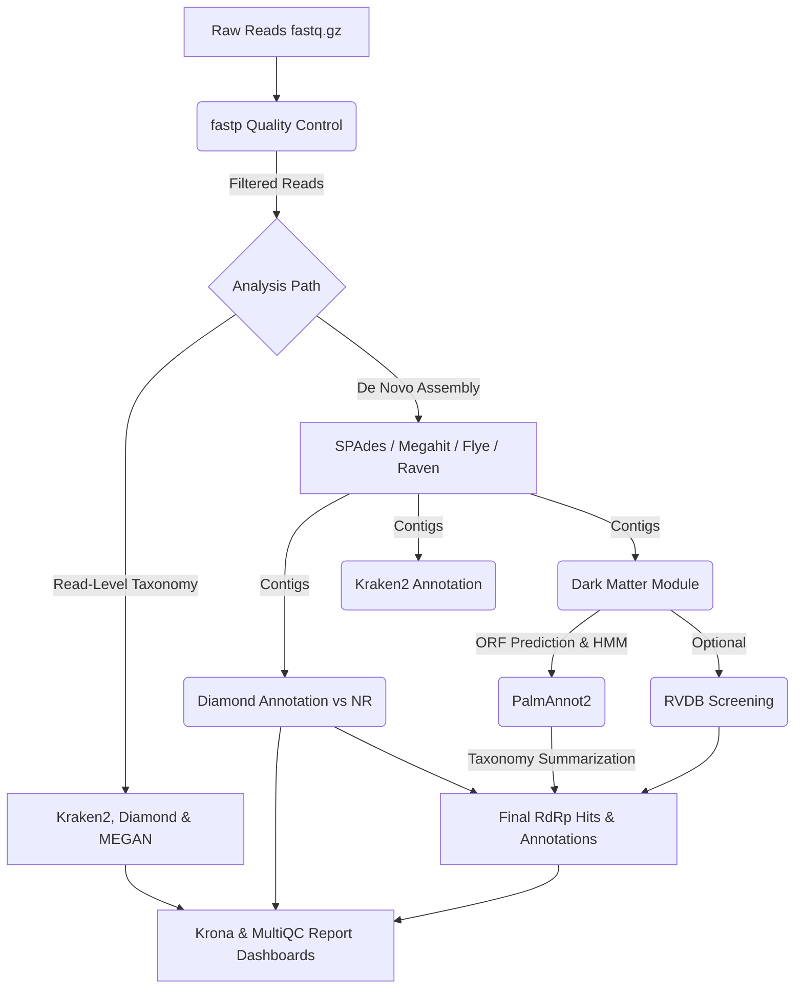
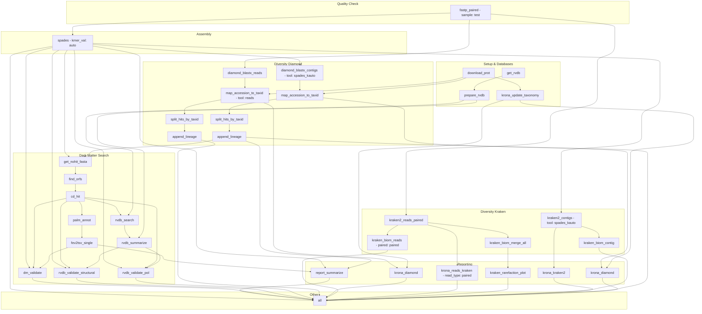

# 🇬🇧 DeepVir Pipeline Structure (English)

Below is the detailed documentation of the 3-directory repository architecture and execution DAGs of the DeepVir pipeline.

## 📊 Pipeline DAGs

### Pipeline Presentation

### Execution DAG (Slurm / Local Profile)

---

## 📂 Root Directory (`/`) — Launchers & Entry Points

*   **`DeepVir.py`**: Universal pure-Python orchestrator for the entire pipeline. It parses CLI arguments, launches the Desktop GUI (`--gui`), bridges Windows executions to WSL2 automatically, resolves Conda environments, writes dynamic run overrides (`logs/run_overrides.yaml`), and triggers Snakemake.
*   **`DeepVir_gui.bat`**: 1-click launcher for **Windows** (detects native Python or falls back to WSL2).
*   **`DeepVir_gui.command`**: 1-click launcher for **macOS** (Finder double-click).
*   **`DeepVir_gui.sh`**: 1-click launcher for **Linux / WSL**.
*   **`README.md`**: Main project overview, quick-start instructions, and links to tutorials.

---

## 📂 1. `pipeline/` — Pipeline Backend & GUI Engine

Contains the entire codebase, configuration files, Snakemake workflow, and graphical interface:

*   **`pipeline/config/config.yaml`**: Static global workflow parameters (SPAdes K-mer sizes, E-value cutoffs, Flye/Medaka settings, default database paths).
*   **`pipeline/gui/deepvir_gui.py`**: Interactive Tkinter/TTK Desktop Dashboard for configuring parameters, monitoring real-time execution, and opening HTML reports.
*   **`pipeline/profiles/`**: Snakemake computational profiles:
    *   `local/`: For local workstations, laptops, and WSL2 environments.
    *   `profile_slurm/`: For High-Performance Computing (HPC) clusters managed by Slurm.
*   **`pipeline/resources/`**: External databases (`diamond/`, `kraken2/`, `taxonomy/`), PalmAnnot HMM models (`palm_annot/`), and institutional logos (`logo/`).
*   **`pipeline/workflow/`**:
    *   `Snakefile`: Master Snakemake entry point.
    *   `multiqc_config.yaml`: Visual layout configuration for MultiQC reports.
    *   `envs/`: Reproducible Conda environment YAML specifications for each bioinformatics tool (`spades`, `diamond`, `kraken2`, `kraken2_biom`, `palm_annot`, `report`, etc.).
    *   `rules/`: Modular Snakemake rule files (`.smk`) including `get_data.smk`, `fastp.smk`, `denovo.smk`, `diamond.smk`, `kraken2.smk`, `lineage.smk`, `megan.smk`, `basta.smk`, `darkmatter.smk`, `RVDB.smk`, `reporting.smk`, and `krona.smk`.
    *   `scripts/`: Helper Python and R scripts (`functions.py`, `dm_validate.py`, `palm_annot_run.py`, `generate_report.R`, `Report_Model.Rmd`).

---

## 📂 2. `docs/` — License & Documentation

Contains the software license and all Markdown tutorials:
*   **`LICENSE`**: GNU General Public License v3.0 (GPL v3).
*   **`local_use.md`**: First-time local setup and Python CLI / GUI quick start.
*   **`desktop_gui.md`**: Complete guide to the Desktop GUI and visual components.
*   **`full_databases_setup.md`**: Production database preparation for Kraken2 and DIAMOND NR.
*   **`hpc_use.md`**: Running DeepVir on Slurm HPC clusters with `python3 DeepVir.py`.
*   **`advanced_tutorial.md`**: Tuning `fastp`, assemblers, and downstream parameters.
*   **`public_data_usage.md`**: Downloading and analyzing NCBI SRA datasets.
*   **`expected_outputs.md`**: Overview of `results/` and `logs/` structures.
*   **`structure_and_dags/workflow_structure.md`**: This trilingual architecture and DAG guide.

---

## 📂 3. `logs/` — Centralized Execution Logs

Stores all runtime logs and configuration snapshots:
*   **`logs/<sample>/*.log`**: Per-sample logs generated by each Snakemake rule.
*   **`logs/workflow/*.log`**: Global workflow logs (MultiQC, Krona taxonomy, RVDB database setup).
*   **`logs/run_overrides.yaml`**: Dynamic configuration generated by `DeepVir.py` for the active run (plus timestamped archives `run_overrides_<timestamp>.yaml`).
*   **`logs/deepvir_desktop_gui.log`**: Diagnostic log from the 1-click GUI launchers.

 

 

# 🇧🇷 Estrutura do Pipeline DeepVir (Português)

Abaixo está a documentação detalhada da arquitetura em 3 diretórios principais e dos pontos de entrada em Python do pipeline DeepVir.

## 📂 Diretório Raiz (`/`) — Executores e Atalhos 1-Clique

*   **`DeepVir.py`**: Executor universal em Python puro do pipeline. Recebe parâmetros via linha de comando (CLI) ou abre a interface gráfica (`--gui`), traduz caminhos automaticamente entre Windows e WSL2, gerencia os ambientes Conda, gera `logs/run_overrides.yaml` e aciona o Snakemake.
*   **`DeepVir_gui.bat`**: Executável de 1 clique para **Windows** (usa Python nativo ou WSL2 automaticamente).
*   **`DeepVir_gui.command`**: Executável de 1 clique para **macOS** (duplo-clique no Finder).
*   **`DeepVir_gui.sh`**: Executável de 1 clique para **Linux / WSL**.
*   **`README.md`**: Documentação principal do projeto, instruções rápidas de uso em Python e links para os tutoriais.

---

## 📂 1. `pipeline/` — Código-Fonte do Pipeline e Backend

Concentra todo o motor do fluxo de trabalho, configurações e interface gráfica:

*   **`pipeline/config/config.yaml`**: Parâmetros técnicos globais (K-mers do SPAdes, limiares de E-value, modelos Flye/Medaka e caminhos padrão).
*   **`pipeline/gui/deepvir_gui.py`**: Painel gráfico Desktop (Tkinter/TTK) para configuração, monitoramento em tempo real e visualização de relatórios HTML.
*   **`pipeline/profiles/`**: Perfis computacionais do Snakemake (`local/` para execução local/WSL e `profile_slurm/` para clusters HPC com Slurm).
*   **`pipeline/resources/`**: Bancos de dados (`diamond/`, `kraken2/`, `taxonomy/`), modelos HMM do PalmAnnot (`palm_annot/`) e logotipos (`logo/`).
*   **`pipeline/workflow/`**:
    *   `Snakefile`: Arquivo mestre de entrada do Snakemake.
    *   `multiqc_config.yaml`: Configurações visuais do relatório MultiQC.
    *   `envs/`: Arquivos YAML dos ambientes Conda reprodutíveis para cada ferramenta.
    *   `rules/`: Regras modulares do Snakemake (`.smk`: `get_data.smk`, `fastp.smk`, `denovo.smk`, `diamond.smk`, `kraken2.smk`, `lineage.smk`, `megan.smk`, `basta.smk`, `darkmatter.smk`, `RVDB.smk`, `reporting.smk`, `krona.smk`).
    *   `scripts/`: Scripts auxiliares em Python e R (`functions.py`, `dm_validate.py`, `palm_annot_run.py`, `generate_report.R`, `Report_Model.Rmd`).

---

## 📂 2. `docs/` — Licenças e Documentações

Reúne a licença legal e todos os manuais em Markdown:
*   **`LICENSE`**: Termos legais da licença GNU GPL v3.
*   **`local_use.md`**, **`desktop_gui.md`**, **`full_databases_setup.md`**, **`hpc_use.md`**, **`advanced_tutorial.md`**, **`public_data_usage.md`**, **`expected_outputs.md`** e **`structure_and_dags/workflow_structure.md`**.

---

## 📂 3. `logs/` — Logs Centralizados de Execução

Armazena todos os registros de execução e snapshots de configuração:
*   **`logs/<sample>/*.log`**: Logs individuais de cada regra do Snakemake por amostra.
*   **`logs/workflow/*.log`**: Logs globais do workflow (MultiQC, taxonomia Krona, preparação RVDB).
*   **`logs/run_overrides.yaml`**: Arquivo dinâmico gerado pelo `DeepVir.py` a cada rodada (com histórico `run_overrides_<timestamp>.yaml`).
*   **`logs/deepvir_desktop_gui.log`**: Log de inicialização da interface gráfica Desktop.

 

 

# 🇫🇷 Structure du Pipeline DeepVir (Français)

Vous trouverez ci-dessous la documentation détaillée de l'architecture en 3 répertoires principaux du pipeline DeepVir et de son exécuteur universel en Python.

## 📂 Répertoire Racine (`/`) — Exécuteur Python & Lanceurs 1-Clic

*   **`DeepVir.py`**: Orchestrateur universel en Python pur. Il gère les arguments CLI, lance l'interface graphique (`--gui`), assure le pont automatique Windows ↔ WSL2, active Conda, génère `logs/run_overrides.yaml` et déclenche Snakemake.
*   **`DeepVir_gui.bat`**: Lanceur 1-clic pour **Windows** (avec support WSL2).
*   **`DeepVir_gui.command`**: Lanceur 1-clic pour **macOS** (Finder).
*   **`DeepVir_gui.sh`**: Lanceur 1-clic pour **Linux / WSL**.
*   **`README.md`**: Documentation principale du projet.

---

## 📂 1. `pipeline/` — Code Backend & Interface Graphique

*   **`pipeline/config/config.yaml`**: Paramètres techniques globaux (tailles de K-mers SPAdes, seuils E-value, options Flye/Medaka).
*   **`pipeline/gui/deepvir_gui.py`**: Tableau de bord graphique Desktop (Tkinter/TTK).
*   **`pipeline/profiles/`**: Profils d'exécution Snakemake (`local/` et `profile_slurm/`).
*   **`pipeline/resources/`**: Bases de données, modèles HMM (`palm_annot/`) et logos (`logo/`).
*   **`pipeline/workflow/`**: Contient le `Snakefile`, `multiqc_config.yaml`, les environnements Conda (`envs/`), les règles modulaires (`rules/*.smk`) et les scripts Python/R (`scripts/`).

---

## 📂 2. `docs/` — Licence & Documentation Markdown

*   **`LICENSE`**: Licence logicielle GNU GPL v3.
*   Tutoriels complets en Markdown (`local_use.md`, `desktop_gui.md`, `full_databases_setup.md`, `hpc_use.md`, `advanced_tutorial.md`, `public_data_usage.md`, `expected_outputs.md`, `structure_and_dags/workflow_structure.md`).

---

## 📂 3. `logs/` — Journaux d'Exécution Centralisés

*   **`logs/<sample>/*.log`**: Journaux d'exécution Snakemake par échantillon et par règle.
*   **`logs/workflow/*.log`**: Journaux globaux du workflow.
*   **`logs/run_overrides.yaml`**: Configuration dynamique générée par `DeepVir.py` à chaque exécution.
*   **`logs/deepvir_desktop_gui.log`**: Journal de diagnostic de l'interface graphique.
